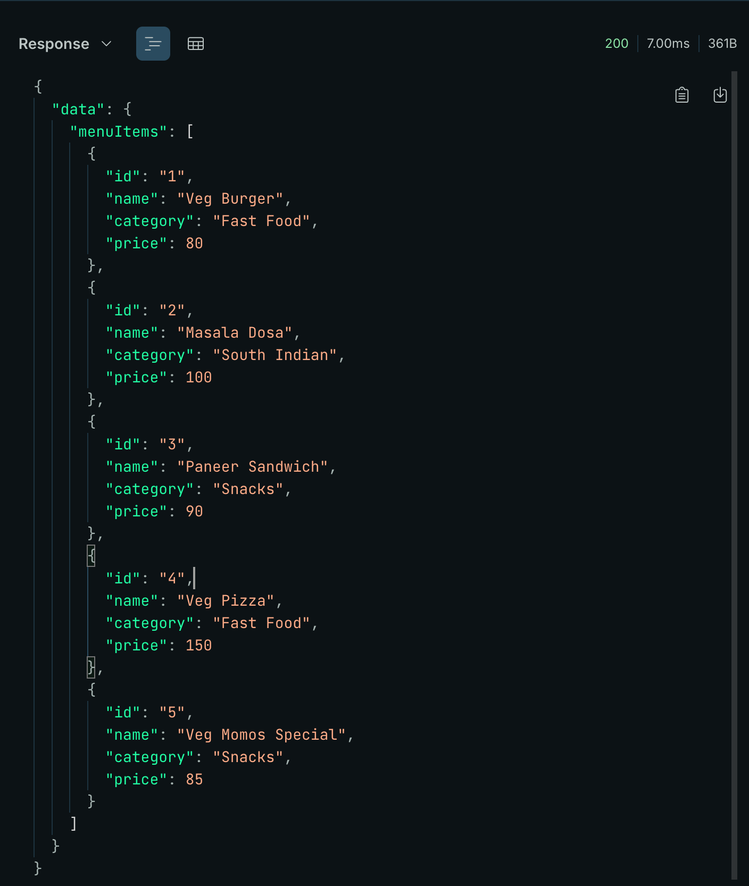
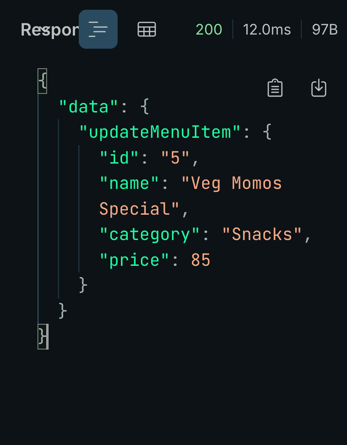
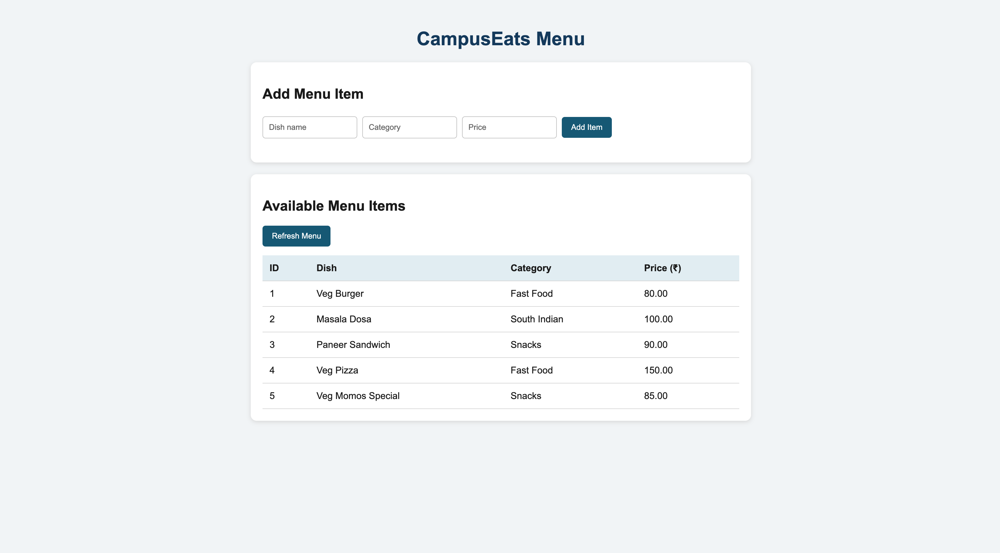
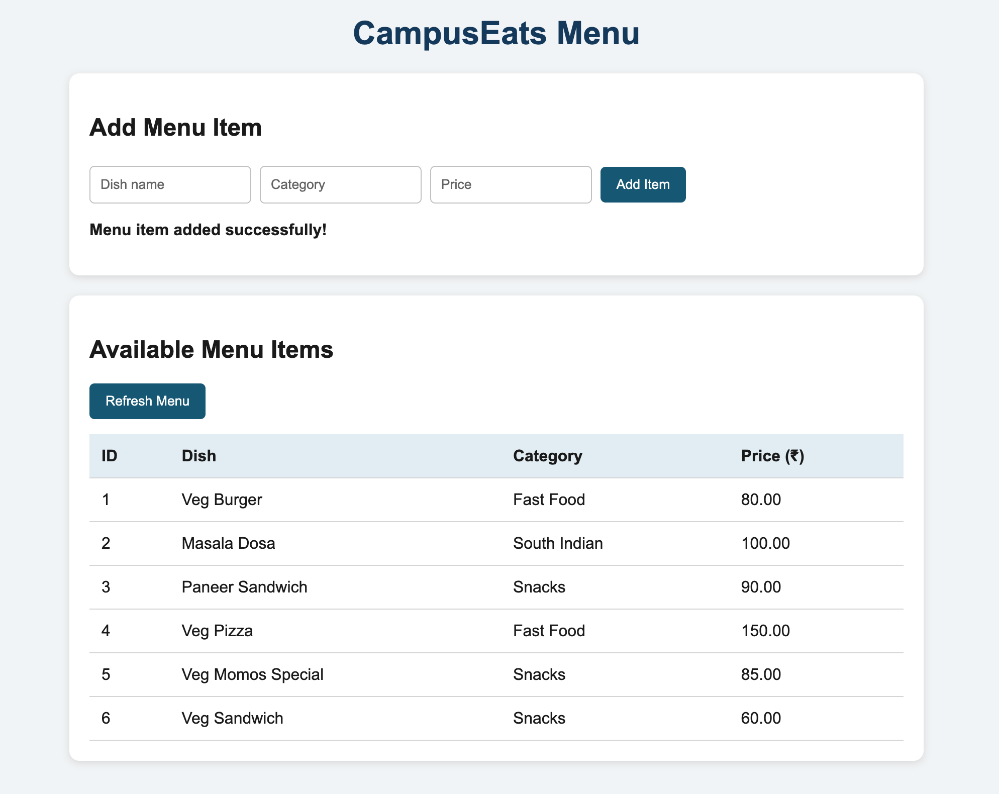

# CampusEats – GraphQL Menu Service

## 1. Selected Service
We selected the **Menu Items Service** for CampusEats. It allows users to view menu items, search for a menu item by ID, add a new menu item, and update an existing menu item.

## 2. Group Members

Annu Kumari (Team Leader) -   Roll No - 20251651024
Akanksha Upadhyay       -     Roll No - 20251651011
Prerna.                 -     Roll No - 20251651072

## 3. Technologies Used
- Node.js
- Express.js
- GraphQL
- Apollo Server
- MySQL
- mysql2
- HTML, CSS, and JavaScript

## 4. Project Structure
- `schema.graphql` – GraphQL object types, queries, and mutations.
- `schema.sql` – SQL script to create the database table and insert sample records.
- `db.js` – MySQL database connection.
- `server.js` – Express server, GraphQL server, and SQL resolvers.
- `public/index.html` – Frontend page to display and add menu items.
- `README.md` – Project documentation and run instructions.

## 5. How to Run the Project

### Prerequisites
Install Node.js and MySQL.

### Step 1: Create the Database
Create the database and table using `schema.sql`. The initial sample data contains four menu items.

### Step 2: Configure the Database
In `db.js`, configure the MySQL host, username, password, and database name according to your local MySQL setup.

### Step 3: Install Dependencies
Run the following command in the project directory:

```bash
npm install
```

### Step 4: Start the Server
Run:

```bash
node server.js
```

The server runs at `http://localhost:4000`.

The GraphQL endpoint is `http://localhost:4000/graphql`.

The frontend is available at `http://localhost:4000`.

## 6. GraphQL Queries and Mutations

### Fetch All Menu Items
```graphql
query {
  menuItems {
    id
    name
    category
    price
  }
}
```

### Fetch One Menu Item by ID
```graphql
query {
  menuItem(id: "1") {
    id
    name
    category
    price
  }
}
```

### Add a Menu Item
```graphql
mutation {
  addMenuItem(name: "Veg Sandwich", category: "Snacks", price: 60) {
    id
    name
    category
    price
  }
}
```

### Update a Menu Item
```graphql
mutation {
  updateMenuItem(id: "5", name: "Veg Momos Special", category: "Snacks", price: 85) {
    id
    name
    category
    price
  }
}
```

## 7. Assignment Questions

### Q1. Which service did you select?
We selected the Menu Items Service. It provides operations to list menu items, fetch an item by ID, add an item, and update an item.

### Q2. Which field can the client skip, and which field cannot be skipped? What does `!` mean?
In GraphQL, a client can omit fields it does not need from the selection set, provided the selected object fields satisfy GraphQL's selection rules. The exclamation mark (`!`) indicates a non-null type. A non-null field cannot return `null`, and a non-null argument must be supplied by the client.

For example, `name: String!` means the name must not be null.

### Q3. How is a query argument mapped to SQL WHERE?
The `menuItem(id: ID!)` query receives the ID as a resolver argument. The resolver passes it to a parameterized SQL query:

```sql
SELECT id, name, category, price
FROM menu_items
WHERE id = ?;
```

The ID is passed separately as a parameter to `pool.execute()`, rather than being concatenated into the SQL string.

### Q4. Which resolver handles INSERT?
The `addMenuItem` mutation resolver executes a parameterized `INSERT INTO menu_items` statement. It then retrieves and returns the newly inserted row using its generated ID.

## 8. Testing
The GraphQL query was tested to retrieve menu items from MySQL. The add and update mutations were tested successfully. The frontend displays menu items and provides a form to add a new menu item.

## 9. Screenshots
Adding  screenshots showing:

1. GraphQL Query Result


2. GraphQL Update Mutation Result


3. Frontend Menu Before Adding an Item


4. Frontend Menu After Adding an Item

